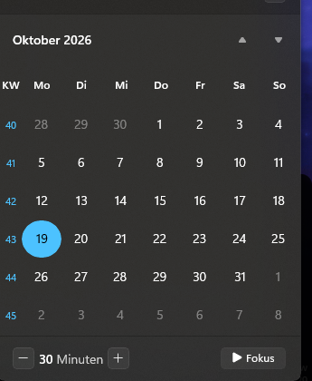

# Taskbar Calendar Week Numbers

A lightweight [Windhawk](https://windhawk.net) mod that adds a **calendar week
column** to the Windows 11 taskbar calendar (the flyout that opens when you
click the clock), similar to the week numbers in Outlook.

*Deutsch: [siehe unten](#deutsch).*

## Features

- Week number column with a header ("KW" on German Windows, "Wk" otherwise)
- ISO 8601 week numbers (default) or the first-week rule from the Windows
  regional settings
- Week numbers in the Windows accent color (same as today's date) or in the
  normal text color
- Configurable column width, font size and opacity
- Follows scrolling and month navigation, works with any first day of week
- No files written, no network access, no background timers. Everything is
  removed again when the mod is disabled.

## Installation

1. Install [Windhawk](https://windhawk.net).
2. In Windhawk choose **Create a new mod**.
3. Replace the editor content with
   [`taskbar-calendar-week-numbers.wh.cpp`](taskbar-calendar-week-numbers.wh.cpp).
4. Click **Compile Mod**, then **Exit Editing Mode**. The mod is enabled
   right away. Open the calendar to see the week numbers.

Settings are in Windhawk under the mod's **Settings** tab.

## How it works

The calendar flyout is a XAML `CalendarView` inside `ShellExperienceHost.exe`.
The mod finds it when the flyout window is shown, moves the weekday header and
the day panel to the right by the column width, and adds a header text and a
canvas in the freed space. The canvas holds one label per visible row. The
labels are repositioned whenever the day panel scrolls or is laid out, and the
week number is computed from the date of the row's first day.

The day cells keep their size, so their horizontal margin is reduced to make
them fit the narrower columns.

Tested on Windows 11 build 26220 with Windhawk 1.7.3. `ShellHost.exe` is
included as well because some builds host the flyout there.

## Building and testing

There's nothing to build outside Windhawk. Windhawk compiles the single
`.wh.cpp` file with its bundled Clang. Compile with `-DDEV_LOG` to make the
mod also write its log to
`C:\ProgramData\Windhawk\Engine\ModsWritable\mod-storage\<mod id>\dev.log`.
ShellExperienceHost runs in an app container, so its debug output doesn't
reach a regular debug viewer.

## License

[MIT](LICENSE)

---

## Deutsch

Ein leichtgewichtiger [Windhawk](https://windhawk.net)-Mod, der im Kalender
der Windows-11-Taskleiste (Klick auf die Uhr) eine **Spalte mit
Kalenderwochen** anzeigt.

**Installation:** Windhawk installieren, dort *Create a new mod* wählen, den
Inhalt von
[`taskbar-calendar-week-numbers.wh.cpp`](taskbar-calendar-week-numbers.wh.cpp)
einfügen, *Compile Mod* klicken und den Editor verlassen. Fertig: Beim
nächsten Öffnen des Kalenders sind die Kalenderwochen da.

**Einstellungen** (in Windhawk beim Mod unter *Settings*):

- Wochenzählung: ISO 8601 (Standard, in Deutschland üblich) oder nach den
  Windows-Regionaleinstellungen
- Spaltenüberschrift: leer bedeutet automatisch „KW“, ein Leerzeichen
  blendet sie aus
- Farbe: Akzentfarbe (wie der heutige Tag) oder normale Textfarbe
- Spaltenbreite, Schriftgröße und Deckkraft
